# JiggleKit Free - Bone Jiggle Physics for Blender (8 bones)

Website: https://mendboxstudio.com · Manual: https://mendboxstudio.com/docs/jigglekit · Updates: https://mendboxstudio.com/updates

> **Get the full version: unlimited bones, same add-on, same files. [JiggleKit on Gumroad](https://mendbox.gumroad.com/l/jigglekit) - $12 launch price.**
> Site: [mendboxstudio.com](https://mendboxstudio.com) · Free updates: [mendboxstudio.com/updates](https://mendboxstudio.com/updates)

JiggleKit Free is a free, open-source Blender add-on for jiggle physics on bones. Select an area of your character mesh, press **Create Jiggle from Selection**, and it places the bone or bone chain, blends the weights into your existing weights and turns on live spring physics. Hair, tails, ears, cloth flaps, accessories. It has **every feature of the full version**, limited to **8 simulated bones** per file.

**Works on Windows, macOS and Linux (Blender 4.2+).**

[Download the latest release](https://github.com/mendbox/jigglekit-free/releases/latest) · [Trailer on YouTube](https://youtu.be/to3ti_8YJAQ)

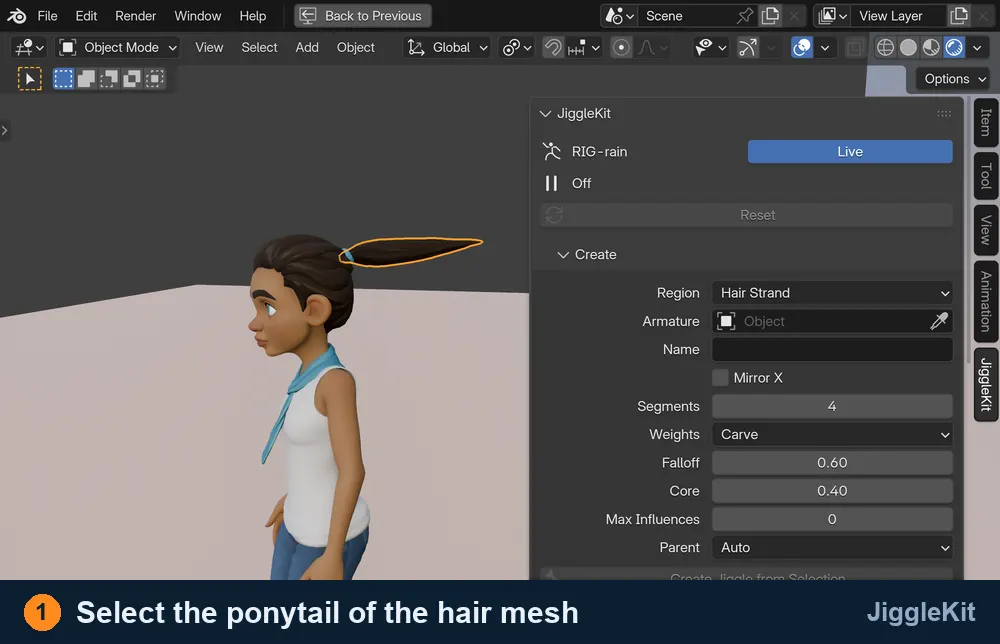
*Hair, tail and cloth on a character, set up from a selected area of the mesh.*

## Features

### One click from a selected area
Select an area in Edit Mode (an ear, a tail, a hair strand, a cloth flap, an accessory), pick the Region and press **Create Jiggle from Selection**. JiggleKit places the bones, builds the weights and turns on the physics. Weights are blended into your existing weights: every vertex keeps the same total, so the rig does not get holes. It works with concave polygons, n-gons and triangles because it uses vertices, not a proxy mesh.

### Already rigged hair or tail
Select the bones in Pose Mode and press **Add Chains from Selected Bones**. Your weights are not touched.

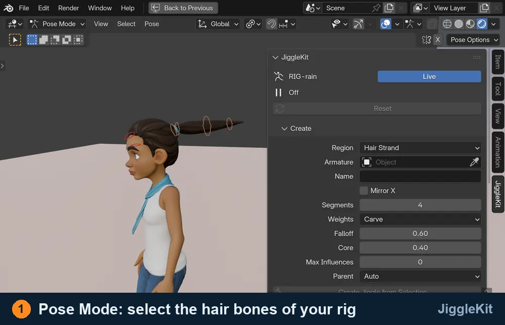

### Presets
Presets for ears, hair strand, tail, cloth flap and accessory, then tune Stiffness, Damping, Inertia, Gravity and Angle Limit per chain while the animation plays.

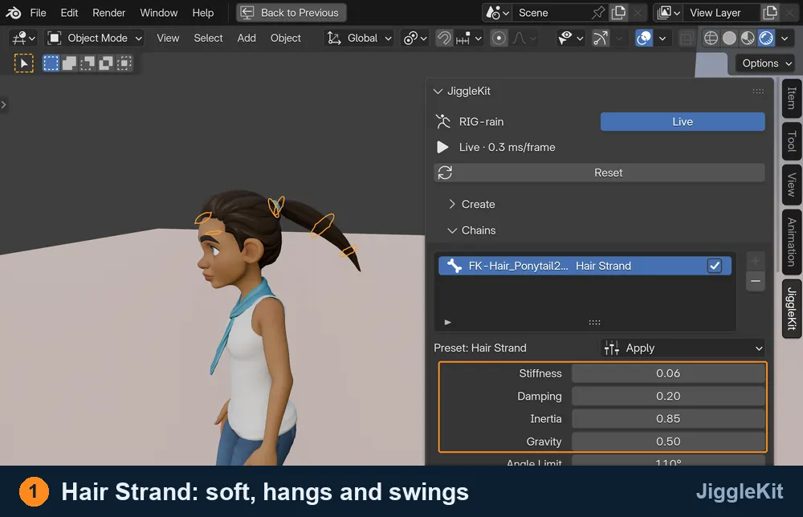

### Live preview and the cost per frame
Physics runs live during playback, and scrubbing back over frames you have already played is instant. The panel shows how many milliseconds the simulation takes per frame, so you see what your rig costs.

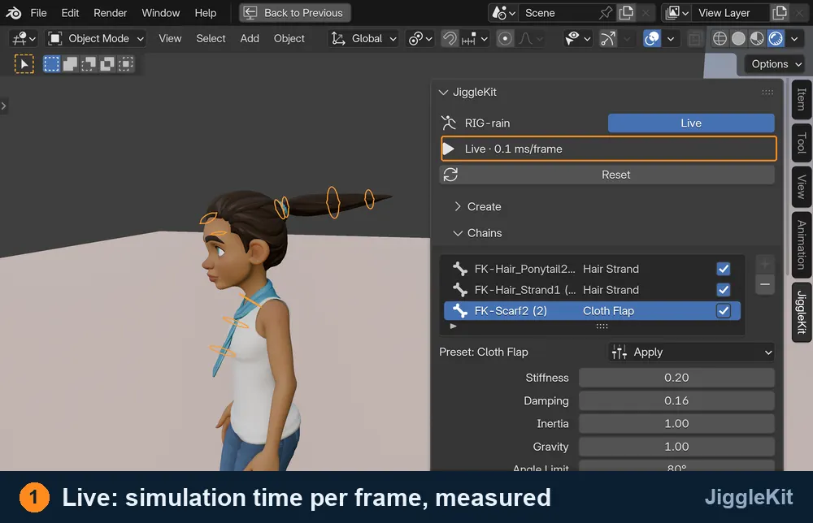

### Buckle and tip damping
Per-chain **Buckle** lets a strand bend and bounce on vertical motion, and **Tip Damping** settles the end of a chain, so a ponytail does not swing as a stiff stick.

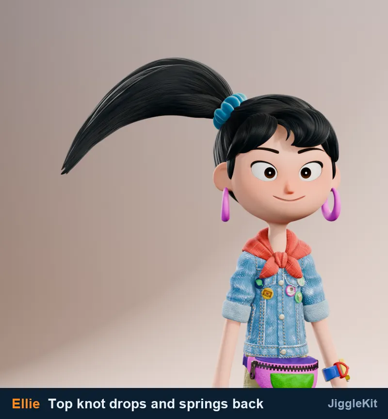

### Real characters
A ponytail and a scarf, a ponytail with accessories: the same add-on on rigged characters.

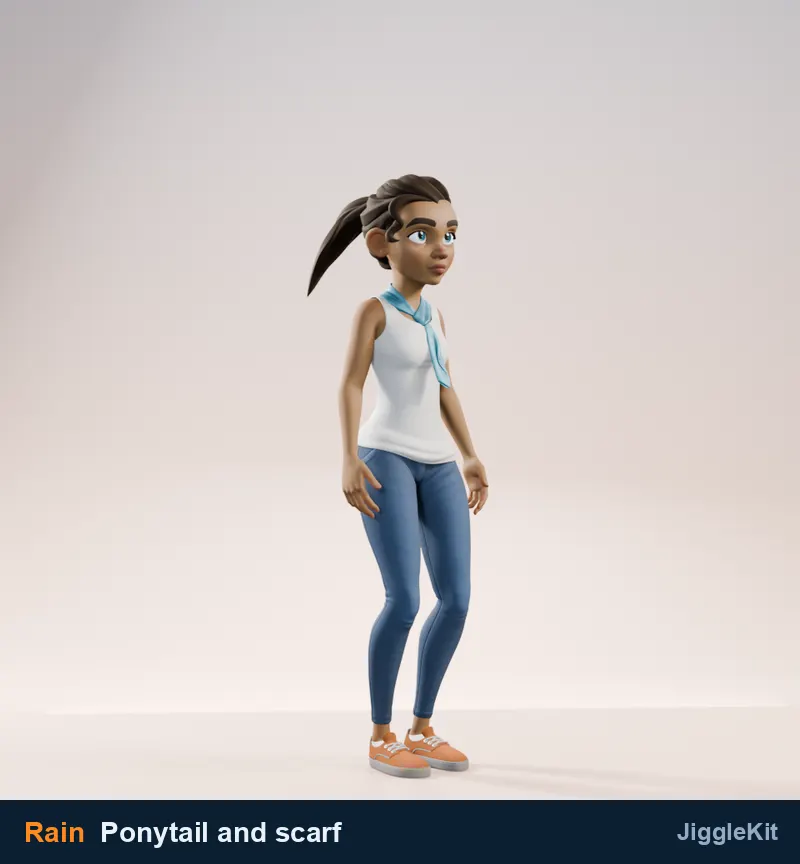

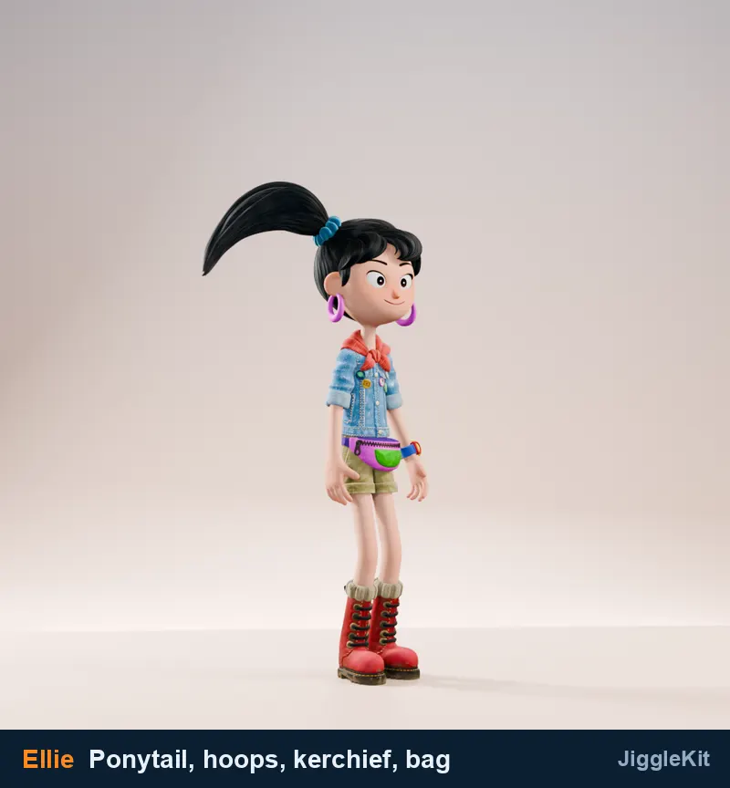

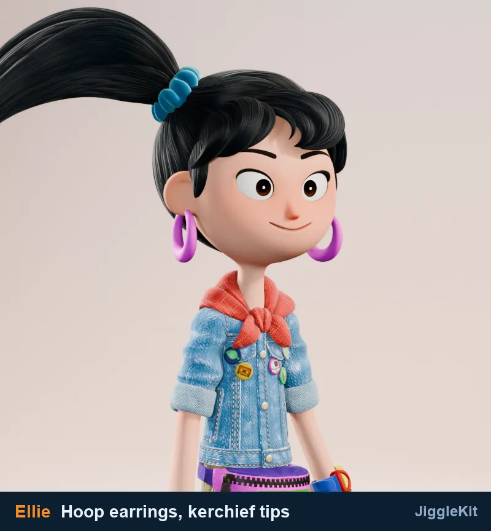

### Colliders
Capsule and sphere colliders bound to bones or objects, created automatically from selected body bones and drawn in the viewport, so soft parts do not pass through the body.

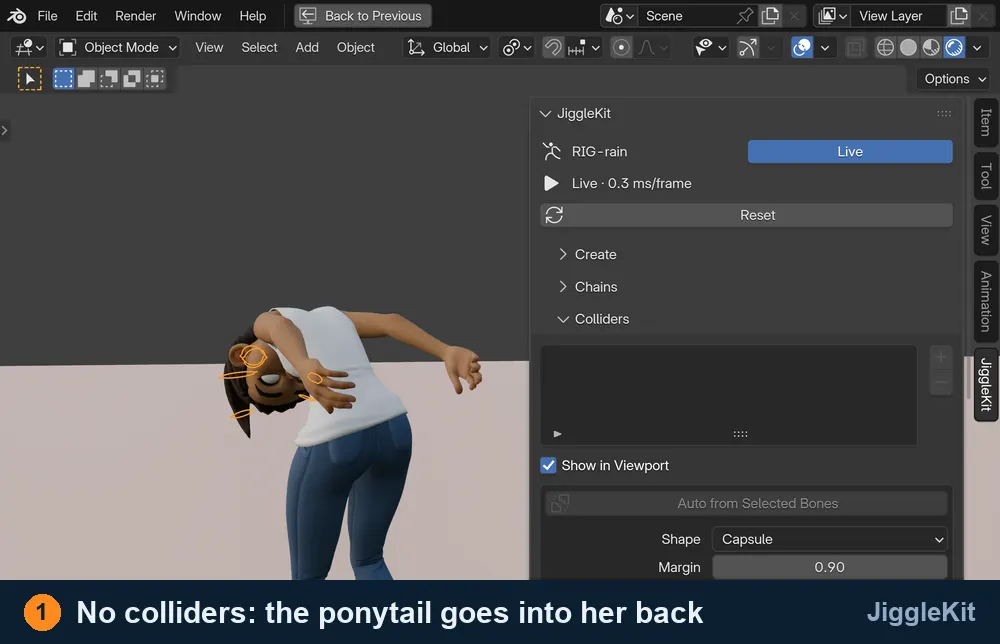

### Switch it off and on
The simulation can be turned off and on for the whole rig, so you can compare with and without jiggle.

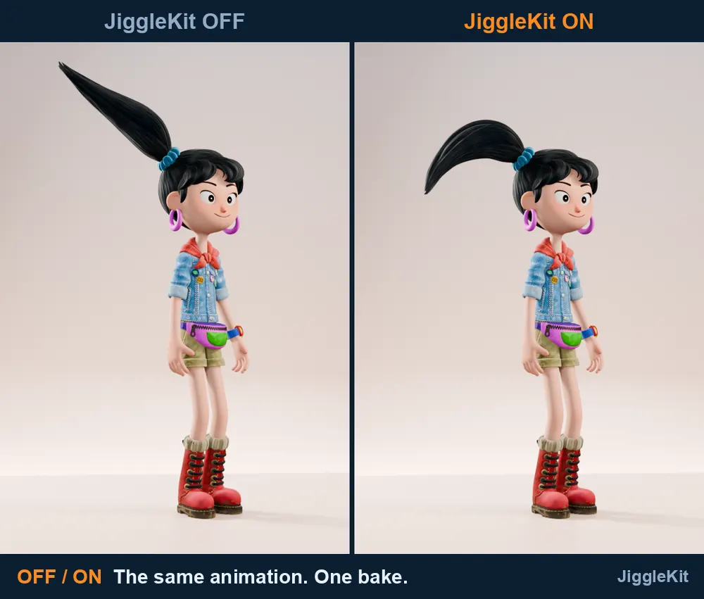

### Bake to keyframes
**Bake to Keyframes** writes ordinary rotation keys on the jiggle bones, on a new NLA track or into the active action. Baking is repeatable: the same input gives the same keys. Export the baked action with FBX or glTF like any other bone animation.

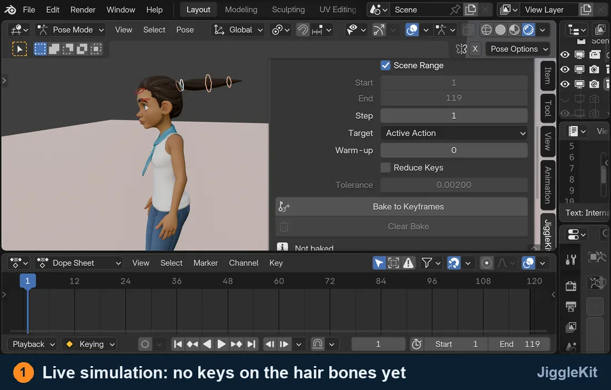

## Install

1. Download `jigglekit_demo-1.0.0.zip` from the [latest release](https://github.com/mendbox/jigglekit-free/releases/latest). Do not unzip it.
2. In Blender: **Edit > Preferences > Get Extensions**, open the menu in the top right corner (the arrow), choose **Install from Disk...** and pick the zip. (You can also drag the zip into the Blender window.)
3. Make sure the add-on is switched on. The panel is in the 3D Viewport sidebar (press **N**), tab **JiggleKit**.

Works on Windows, macOS and Linux (Blender 4.2+). Pure Python with the numpy that ships inside Blender: no compiled modules, no internet access, no extra libraries.

## The 8-bone limit

JiggleKit Free simulates **up to 8 bones per file**. If a file has more, the first 8 by chain order are simulated, the panel shows a note, and a 9th bone is refused by the create operators. Everything else is the same as in the full version: all regions and presets, colliders, live preview, Buckle and Tip Damping, bake.

**The full version has no bone limit.** Files made in Free open in the full version without conversion, and the full version replays them identically. Get it here: [JiggleKit on Gumroad](https://mendbox.gumroad.com/l/jigglekit) ($12 launch price).

## Limits

- Rotation-only bone physics: no bone stretch and no soft-body mesh.
- Collision with spheres and capsules only. No mesh collision and no self collision.
- One-way: the tip does not pull the root, and the body does not react to the jiggle.
- Live speed depends on your rig; the panel shows it. On heavy characters, bake.
- Weights from one click are a strong starting point; on complex areas check them and touch up with the brush.
- Bones with Copy Rotation, Damped Track, IK and similar constraints override the jiggle; the panel names the constraint. On Rigify, jiggle the controller bones.
- Blender 5 does not save add-on changes made on a library override: set up the jiggle in the library file.

## Credits

The characters in the demo animations are CC-BY rigs from Blender Studio:

- Rain Rig (CC-BY) Blender Foundation | studio.blender.org, https://studio.blender.org/characters/rain/v3/
- Ellie Rig (CC-BY) Blender Foundation | studio.blender.org, https://studio.blender.org/characters/ellie/

The characters are not included in this repository.

## Get the full version

JiggleKit Free is the same add-on with an 8-bone cap. For characters with more hair, tails, ears and cloth:

**[Get JiggleKit (unlimited bones) on Gumroad - $12 launch price](https://mendbox.gumroad.com/l/jigglekit)**

Site: https://mendboxstudio.com · Updates: https://mendboxstudio.com/updates · Support: support@mendboxstudio.com

## License

GPL-3.0-or-later, see [LICENSE](LICENSE). The add-on source is in [`jigglekit_demo/`](jigglekit_demo).

---
*Keywords: Blender add-on, Blender extension, jiggle physics, jiggle bones, bone physics, spring bones, secondary motion, hair physics, tail physics, ear physics, cloth flap, character animation, rigging, bake to keyframes, colliders.*
